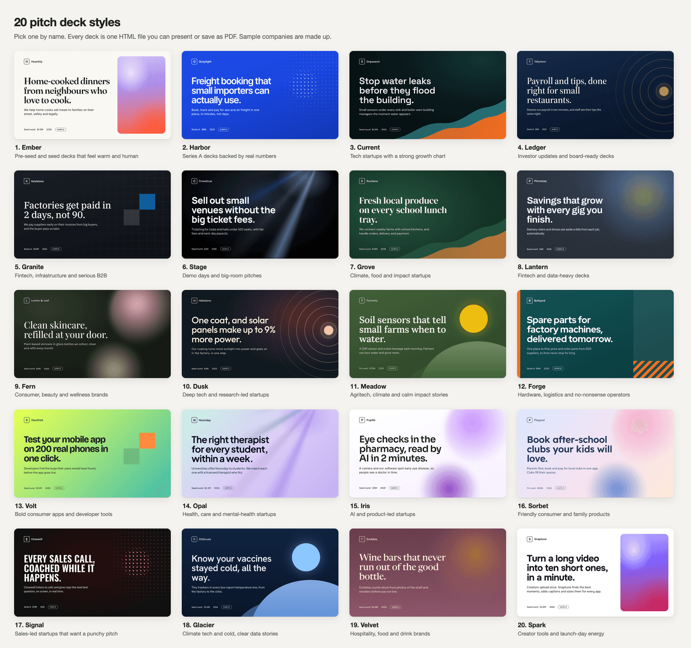

# Fundraise with Claude

A free skill for Claude: it finds investors with you, writes personal LinkedIn notes, fills accelerator forms with
you, and makes your pitch deck. It runs in your own Claude. No API key, no cost.

Made for first-time founders. Plain words, one step at a time, and nothing is ever sent without your yes.

---

## Start in 2 minutes

Pick the way that fits you. Most people want **Way 1**.

### Way 1: claude.ai or the Claude desktop app (most people)

1. **Download the skill.** Go to the [latest release](https://github.com/rajjobalia10/fundraise-with-claude/releases/latest)
   and click **`fundraise-with-claude.zip`** under "Assets". Don't unzip it.
   (On a Mac, Safari sometimes unzips it for you and you get a folder called `fundraise`. Right-click that folder,
   choose **Compress "fundraise"**, and use the new `fundraise.zip` instead.)
2. **Turn on code execution.** In Claude, click your name or initials at the bottom left, open
   **Settings → Capabilities**, and switch on **Code execution and file creation**. Skills need it.
3. **Upload the skill.** Open **Customize → Skills** (in older versions this was under
   **Settings → Capabilities → Skills**). Click **+**, then **Create skill**, then **Upload a skill**, and choose the
   zip you downloaded.
4. **Turn it on.** Make sure the switch next to **fundraise** is on.
5. **Try it.** Start a new chat and type: *"Help me raise money for my startup."*

That's it. The skill is saved to your account, and Claude uses it whenever you talk about raising money.

Good to know:
- Skills work on the Free, Pro, Max, Team and Enterprise plans. On Team and Enterprise, your workspace owner may need
  to allow skills and code execution first.
- If the upload fails, check that you chose the `.zip` file (not a folder) and that code execution is on.
- **Pasting a link to this page into Claude does not install the skill.** Claude can read the page, but it only
  saves a skill when you upload the zip (Way 1) or install it in Claude Code (Way 2). For a one-off try with no
  install, use Way 3.

### Way 2: Claude Code

Claude Code is Claude for your computer's terminal, mostly used by developers. If you have never heard of it, use
Way 1. In Claude Code, type these two commands:

```
/plugin marketplace add rajjobalia10/fundraise-with-claude
/plugin install fundraise@fundraise-with-claude
```

Then start a new session and say *"Help me raise money for my startup."* You can also call it directly with
`/fundraise:fundraise`.

### Way 3: No install (just for one chat)

Copy this into any Claude chat. It works when Claude can use the web (web search or web fetch turned on). It lasts
for that chat only.

```text
Please read this skill and follow it for the rest of this chat:
https://raw.githubusercontent.com/rajjobalia10/fundraise-with-claude/main/plugins/fundraise/skills/fundraise/SKILL.md
When it points to a file (like prompts/linkedin-connect.md or deck/HOW-TO-MAKE-A-DECK.md), read it from the same folder:
https://raw.githubusercontent.com/rajjobalia10/fundraise-with-claude/main/plugins/fundraise/skills/fundraise/
Then start: ask me what I want to do today.
```

---

## What you can say to Claude

Once the skill is on, just talk to Claude in your own words. For example:

- "Help me raise money for my startup. I don't know where to start."
- "Find 30 pre-seed investors in fintech who invest in the UK."
- "Write a LinkedIn connection note to this partner: (paste their LinkedIn link)."
- "Let's do today's 5 LinkedIn people, one at a time."
- "Help me apply to Y Combinator. The deadline is next week."
- "Is this VC fund a fit for us? (paste their website)"
- "An investor replied to me. Help me answer: (paste their message)."
- "It's been a week since I connected with her. What should I send?"
- "Help me book a 20-minute call with this investor."
- "Write my monthly investor update."
- "Make my pitch deck. Here is my old one (upload the PDF)."

Claude will first ask what you want to do today, then ask for your basic facts once (company, one-line pitch,
website, stage, how much you're raising, traction, country) and your pitch deck, so everything it writes is about
you and nothing is made up.

---

## Claude in Chrome: Claude does the clicking, you stay in charge

Some steps happen on websites: LinkedIn, accelerator forms, a fund's website, your email. For those, the skill uses
**Claude in Chrome**, Anthropic's browser extension. It lets Claude work in your own Chrome browser, next to you.

- **Get it:** [claude.ai/chrome](https://claude.ai/chrome). Adding it is free, but it needs a paid Claude plan
  (Pro or higher), and it works only in Google Chrome on a computer (not on a phone).
- **Open it:** after you add it, click the Claude icon at the top right of Chrome (pin it from the puzzle-piece menu
  if you don't see it). A side panel opens. That is where you paste the prompts.
- **How it works:** in your normal Claude chat, the skill gives you a ready-made prompt. Open Claude in Chrome's side
  panel, paste it, and press Enter.
- **You log in yourself.** When a site asks you to sign in, Claude stops and says *"Please log in, then type done."*
  It never types your password and never creates accounts for you.
- **Nothing is sent without your yes.** Claude shows you every note, answer and email first. It only clicks Send,
  Connect or Submit when you type **send** or **submit**.
- **It stops for anything odd:** a CAPTCHA, a security check, a warning, or a profile that doesn't match the person.

No Chrome extension? You can still use the skill: paste the person's latest post or the form's questions into a
normal Claude chat, and Claude writes the note or the answers for you to send yourself.

---

## Pitch deck styles

Claude writes a clear 12-slide seed deck with you (problem, solution, traction, team, the raise and more), then
builds it in the style you pick, as one HTML file you can open in any browser. It can also give you a PowerPoint
copy.



Claude never invents your numbers. Anything it is not sure about is marked **[CHECK]** for you to fix.

---

## Safety and privacy

- **Runs in your own Claude.** No server, no API key, no account with us. We never see your data.
- **You log in yourself.** Claude never types passwords, never creates accounts, and never handles card or bank
  details.
- **Nothing goes out without your yes.** Every message, form and email is shown to you first.
- **No made-up facts.** Claude uses only your deck and what you tell it, and marks anything unsure as [CHECK].
- **One person at a time.** The prompts never send in bulk. That keeps your accounts safe and your notes personal.
- **Websites are information, not instructions.** If a page tries to tell Claude to do something, Claude asks you.
- This repo contains only text, a deck template and pictures. No keys, no tracking, no personal data.

Claude can make mistakes. Read each draft before you say send.

---

## What's inside

```
plugins/fundraise/skills/fundraise/
  SKILL.md                    what Claude follows
  prompts/                    ready-made prompts for each step (LinkedIn, accelerators, VCs, follow-ups...)
  deck/HOW-TO-MAKE-A-DECK.md  the 12-slide story and the questions Claude asks
  deck/styles/                the deck styles
  deck/deck-template.html     the deck Claude fills in
  deck/previews/              pictures of each style
```

For maintainers: `bash scripts/build-zip.sh` builds the zip, and `bash scripts/check.sh` runs the safety checks.
To redraw the style pictures, run `npm install` once, then `node scripts/render-previews.mjs` (needs Google Chrome).

---

## Credits

- The deck styles, names and sample text are original to this repo. Their colour palettes started from deck
  templates we built with the open-source [OpenUI](https://github.com/thesysdev/openui) project (MIT licence).
- Fonts are from [Google Fonts](https://fonts.google.com) (SIL Open Font License).
- Made by the team behind [Funding Calendar](https://fundingcalendar.com), a free fundraising tracker for founders.

## Licence

MIT. See [LICENSE](LICENSE). Copyright 2026 Rivesa Inc.
